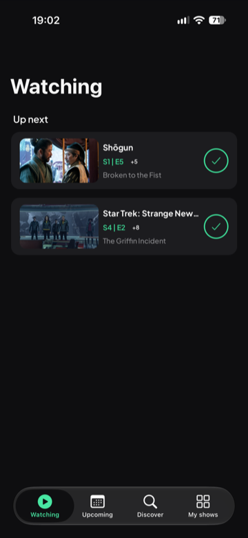
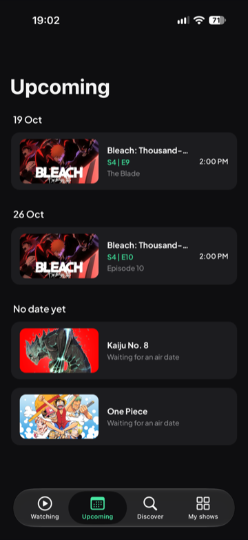
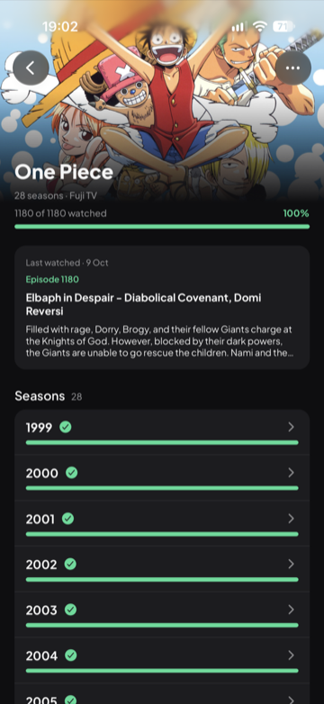
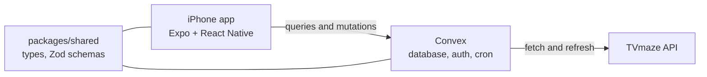

# Showlog

A personal iPhone app for tracking TV shows and anime. Find a show, add it to your list, tick off episodes, see where you left off after a long break, and get a phone alert when a new episode is out. Show data comes from [TVmaze](https://www.tvmaze.com).

Built for one person: me. TV Time shut down, and the replacements did more than I needed.

  
  
  

Walkthrough video and write-up: [dmstudiosgh.com/work/showlog](https://www.dmstudiosgh.com/work/showlog)

## How it fits together

## Engineering decisions

- **A copy of the TVmaze data lives in Convex.** Adding a show fetches it and its episodes once, and a daily job refreshes only the shows TVmaze says changed. The app never waits on TVmaze to open a screen. *Gave up:* the data can be up to a day old, and I own a refresh job and TVmaze's rate limit (retry on 429).
- **Ticks show up instantly, before the server replies.** A tracker is opened for a few seconds to tick one episode, so it has to feel immediate. *Gave up:* a simple "server is the only truth" model. The screen and the database can briefly disagree.
- **One account, and no password reset.** The app ships with the Convex address inside it, so sign-in is what stops anyone from reading or changing my list. The first sign-up creates the account and the server refuses any other. *Gave up:* reset by email. If I forget the password, I change it from the Convex dashboard.

## Stack

- **Phone app:** Expo (SDK 57), Expo Router, React Native, NativeWind — `apps/mobile-app`
- **Backend:** Convex with Convex Auth (email and password) — `convex/`
- **Shared code:** types, helpers, Zod schemas — `packages/shared`
- **Monorepo:** Turborepo with Yarn 1 workspaces

## Setup

Node 22.13 or newer and Yarn 1.22.

1. From the repo root: `yarn install`
2. Start Convex and wait until it says the functions are ready: `yarn dev:backend`. The first run signs you in to Convex and writes the root `.env.local`.
3. Copy `apps/mobile-app/.env.example` to `apps/mobile-app/.env.local` and set `EXPO_PUBLIC_CONVEX_URL` to `CONVEX_URL` from the root `.env.local`.
4. Set the Convex Auth keys once per deployment: `docs/convex-auth-env.md`.
5. In another terminal: `yarn dev:mobile`, then open Showlog(Dev) on the iOS simulator.

## Commands

- `yarn dev:backend` — push Convex functions and watch for changes
- `yarn dev:mobile` — start Metro for the development build
- `yarn lint` — ESLint
- `yarn format:check` — Prettier
- `yarn type-check` — TypeScript for the app, shared, and Convex
- `yarn test:ci` — Convex tests (Vitest), then app and shared tests (Jest)

Phone builds and update pushes: `docs/deployment-guide.md`.

## Docs

- `STATUS.md` — where the work is now
- `docs/product/` — locked decisions and product requirements
- `docs/design/` — screen design and references
- `docs/` — coding guides
- `AGENTS.md` — instructions for coding agents

Show data from TVmaze, licensed [CC BY-SA](https://creativecommons.org/licenses/by-sa/4.0/).
